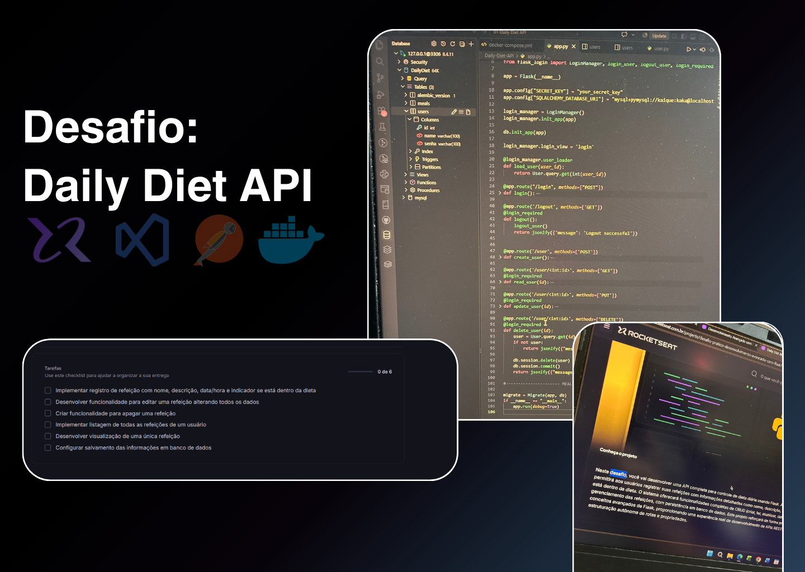
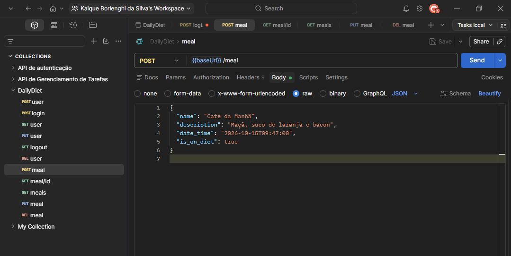
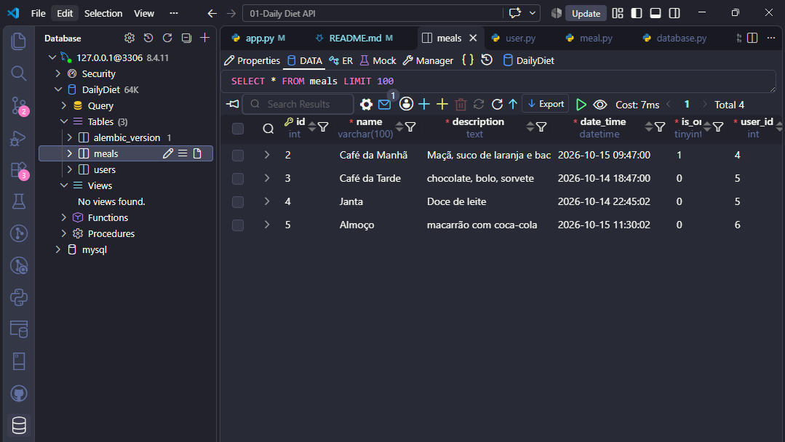

# Daily Diet API

A learning project that explores REST API development with Flask, MySQL, and meal tracking. It lets registered users create, view, update, and delete their own meal records.

<p align="center">
  <!-- Add your project banner to assets/project-banner.png -->
  
</p>

<p align="center">
  
  
  
  
</p>

<p align="center">
  Built as a hands-on challenge proposed by <a href="https://www.rocketseat.com.br/">Rocketseat</a>.
</p>

---

## About the project

The **Daily Diet API** is a small REST API for recording meals and indicating whether each one fits a user's diet. It was built as a practical exercise in Flask routes, relational data modeling, database connectivity, and CRUD operations.

Each meal belongs to a user. Authenticated users can manage their own meals, while meal data is stored in MySQL.

> **Scope:** This is a learning project, not a production-ready service. The implementation focuses on practicing API and database fundamentals.

## Features

- Register users and log in or out.
- Create meals with a name, description, date and time, and diet indicator.
- List the authenticated user's meals.
- Retrieve, update, and delete a meal belonging to the authenticated user.
- Store users and meals in MySQL.
- Use Docker Compose to start a local MySQL database.

## Tech stack

- **Python** — programming language
- **Flask** — web framework and API routes
- **Flask-SQLAlchemy** — ORM and database integration
- **Flask-Migrate** — database migration support
- **Flask-Login** — session-based user authentication
- **MySQL** — relational database
- **PyMySQL** — MySQL driver
- **Docker Compose** — local database setup
- **Postman** — API request testing
- **Visual Studio Code** — development environment

## Data model

### User

| Field | Type | Notes |
| --- | --- | --- |
| `id` | Integer | Primary key |
| `name` | String | User name; required |
| `senha` | String | Password field; required |

### Meal

| Field | Type | Notes |
| --- | --- | --- |
| `id` | Integer | Primary key |
| `name` | String | Meal name; required |
| `description` | Text | Meal details; required |
| `date_time` | DateTime | Meal date and time; required |
| `is_on_diet` | Boolean | Whether the meal fits the diet; required |
| `user_id` | Integer | Foreign key linking the meal to its owner |

The current models do not include `created_at` or `updated_at` fields.

## API routes

The routes below reflect the current implementation. Login uses Flask-Login sessions, so an API client may need to retain and send the session cookie between requests.

| Method | Route | Authentication | Purpose |
| --- | --- | --- | --- |
| `POST` | `/user` | No | Register a user |
| `POST` | `/login` | No | Log in |
| `GET` | `/logout` | Required | Log out |
| `GET` | `/user/<id>` | Required | Retrieve a user |
| `PUT` | `/user/<id>` | Required | Update a user |
| `DELETE` | `/user/<id>` | Required | Delete a user |
| `POST` | `/meal` | Required | Create a meal |
| `GET` | `/meals` | Required | List the authenticated user's meals |
| `GET` | `/meal/<id>` | Required | Retrieve one of the authenticated user's meals |
| `PUT` | `/meal/<id>` | Required | Update one of the authenticated user's meals |
| `DELETE` | `/meal/<id>` | Required | Delete one of the authenticated user's meals |

### Meal request example

Send a JSON body to `POST /meal`:

```json
{
  "name": "Lunch",
  "description": "Rice, beans, and vegetables",
  "date_time": "2026-10-15T12:30:00",
  "is_on_diet": true
}
```

The `date_time` value is expected in ISO 8601 format. The example date is illustrative; use the date and time relevant to your request.

## Getting started

### Prerequisites

- Python 3
- Docker and Docker Compose
- Postman or another API client

### 1. Start the MySQL database

From the project root, run:

```bash
docker compose up -d
```

The Compose file defines the local MySQL service and persists its data in the project directory's `mysql-data/` folder.

### 2. Install the Python dependencies

```bash
pip install Flask Flask-SQLAlchemy Flask-Migrate Flask-Login PyMySQL
```

### 3. Configure the database connection

The current connection string is defined directly in `app.py`. Make sure its host, port, database name, username, and password match your local MySQL configuration before starting the app.

For a safer setup, move the connection string and Flask secret key into environment variables. Do not commit real credentials or secret keys to GitHub.

### 4. Create or update the database tables

Flask-Migrate is initialized in the application. For a new local database, create and apply a migration:

```bash
flask --app app db init
flask --app app db migrate -m "Create user and meal tables"
flask --app app db upgrade
```

If the project already has a `migrations/` directory, skip `db init` and create a new migration only when the models change.

### 5. Run the API

```bash
python app.py
```

The application currently starts with Flask debug mode enabled. Use that only for local development; do not run a debug server in production.

## Testing with Postman

A typical flow for trying the API is:

1. Register a user with `POST /user`.
2. Log in with `POST /login`.
3. Keep the session cookie returned by the login request.
4. Create, list, retrieve, update, or delete meals using the authenticated session.
5. Log out with `GET /logout`.

## Screenshots

Add screenshots to the `assets/` directory and update the paths below as your project develops.

| API requests in Postman | Database tables |
| --- | --- |
|  |  |

## Project structure

The structure may change as the project evolves. A possible layout for the current implementation is:

```text
.
├── app.py
├── database.py
├── docker-compose.yml
├── models/
│   ├── meal.py
│   └── user.py
├── assets/
│   ├── project-banner.png
│   ├── postman-requests.png
│   └── database-tables.png
└── README.md
```

## Security notes

This project is intended for learning. Before using it beyond a local exercise:

- Hash passwords instead of storing or comparing them as plain text. The current implementation does not hash passwords.
- Replace hard-coded database credentials and the placeholder Flask secret key with environment-based configuration.
- Do not commit secrets, local database files, or real user data to the repository.
- Review authorization on the user routes. Meal routes filter records by the authenticated user's ID, but the user routes currently accept a user ID from the URL.

## Acknowledgements

This project was created as part of a challenge proposed by **[Rocketseat](https://www.rocketseat.com.br/)**. Thank you for providing the challenge and learning opportunity.

------
<p align="center">
  <sub >Learning by building, one project at a time.</sub>
</p>